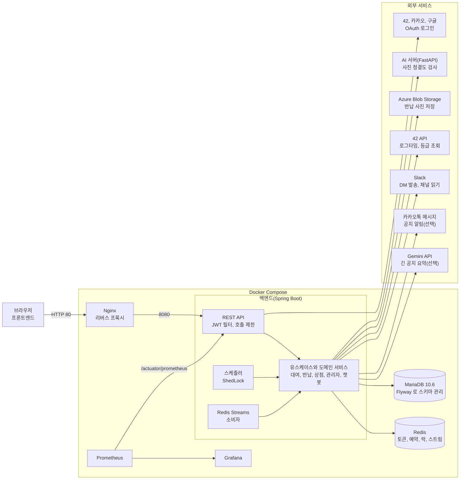
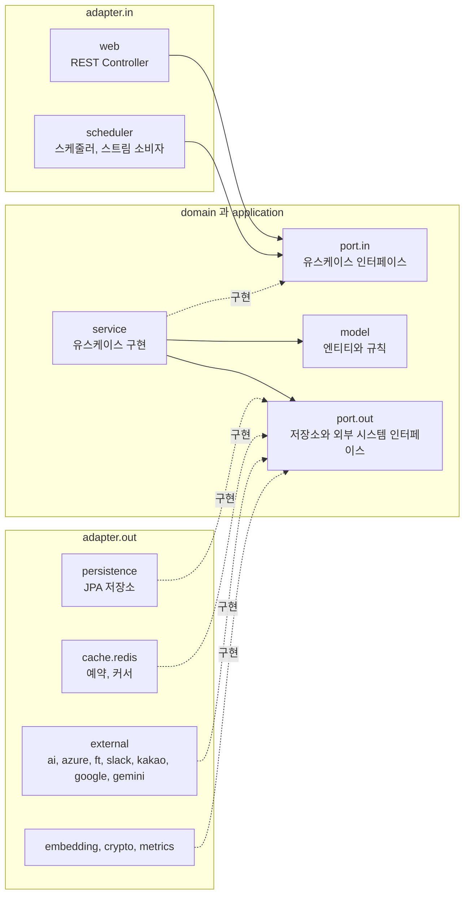
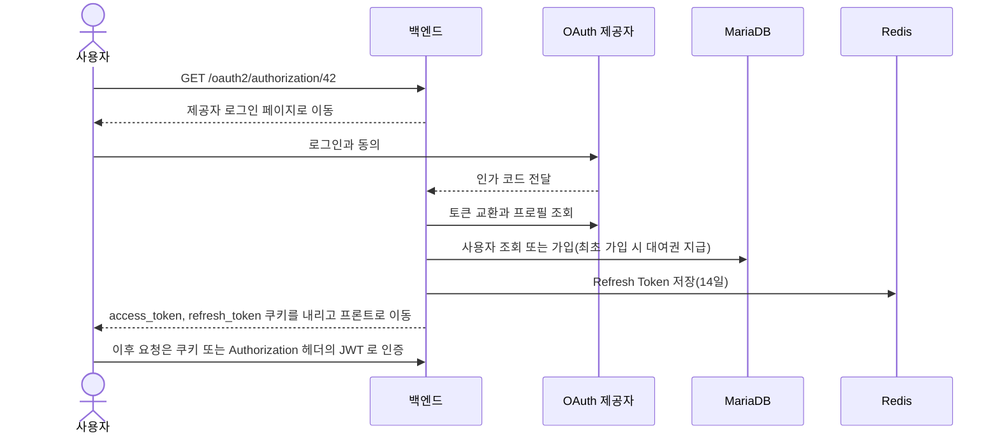
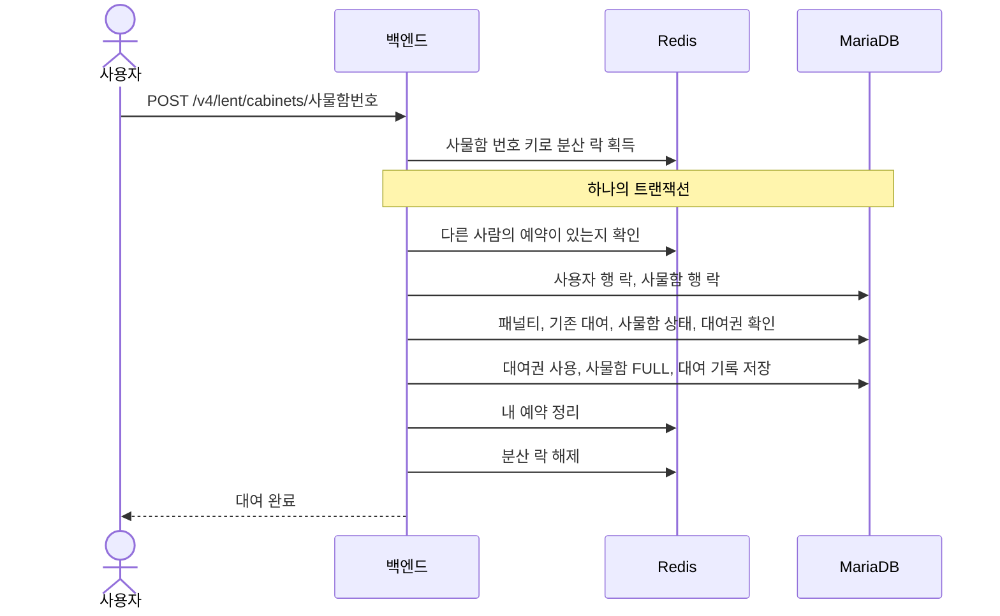
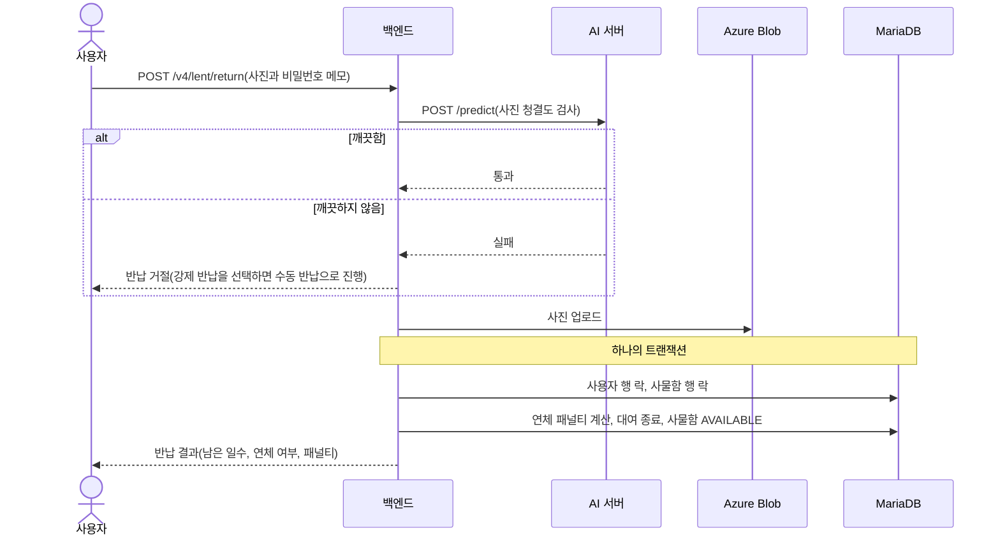
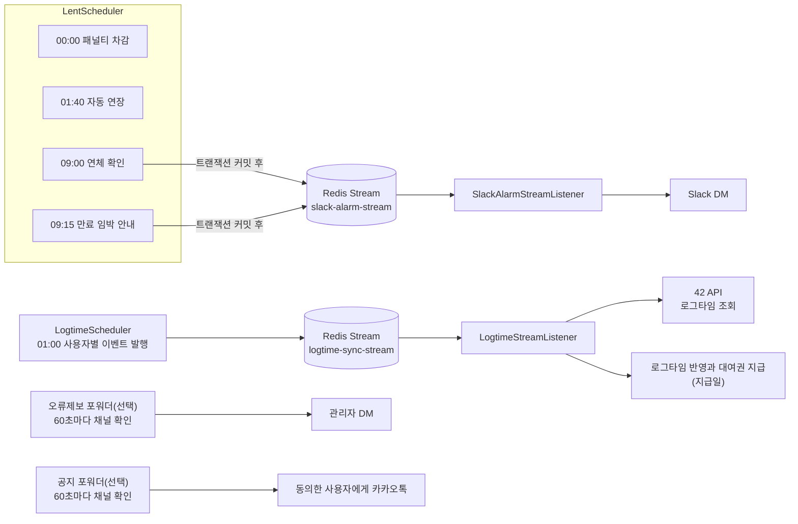

# 42Cabi Gyeongsan

## 1. 서비스 소개

42 경산 캠퍼스의 사물함을 대여하고 반납하는 서비스의 백엔드(REST API 서버)입니다. 학생은 층별 사물함 목록에서 사용 가능한 사물함을 골라 31일 동안 빌릴 수 있고, 기간 안에 연장하거나 다른 사물함으로 옮길 수 있습니다.

주요 기능은 다음과 같습니다.

| 기능 | 설명 |
| --- | --- |
| 대여, 반납, 연장 | 사물함을 31일 동안 대여하고 연장권으로 기간을 늘립니다. 반납할 때는 사물함 사진을 올립니다. |
| 이사와 예약 | 다른 사물함으로 옮깁니다. 옮길 사물함은 15분 동안 예약할 수 있고, 목록과 상세 응답에 예약 여부가 표시됩니다. |
| AI 청결도 검사 | 반납할 때 올린 사진을 AI 서버로 보내 사물함이 깨끗한지 검사합니다. |
| 코인과 대여권 | 출석과 월간 로그타임에 따라 코인과 대여권을 지급하고, 상점에서 아이템을 살 수 있습니다. |
| 관리자 기능 | 사물함 상태를 일괄 변경하고, 작업 기록을 조회하고 되돌릴 수 있습니다. |
| 알림 | 슬랙 오류제보를 관리자 DM으로, 슬랙 공지를 카카오톡으로 전달합니다. 기본값은 꺼져 있습니다. |
| FAQ 챗봇 | 자주 묻는 질문에 미리 써 둔 답변을 찾아 돌려줍니다. 기본값은 꺼져 있습니다. |

기술 스택은 다음과 같습니다.

| 구분 | 사용 기술 |
| --- | --- |
| 언어, 프레임워크 | Java 17, Spring Boot 3.5.8 (Web, Data JPA, Security, OAuth2 Client, WebFlux) |
| 데이터 | MariaDB, Flyway(스키마 마이그레이션), Redis(토큰, 분산 락, 스트림, 예약) |
| 인증 | 42, 카카오, 구글 OAuth 로그인 후 JWT 발급 |
| 안정성 | Resilience4j(서킷 브레이커, 호출 제한), ShedLock |
| 문서와 모니터링 | springdoc(Swagger UI), Actuator, Prometheus, Grafana |
| 실행 | Docker Compose, Nginx |
| 외부 연동 | Slack, Azure Blob Storage, AI 청결도 검사 서버(Python FastAPI) |

### 전체 아키텍처

클라이언트의 요청은 Nginx를 거쳐 Spring Boot 백엔드로 들어옵니다. 백엔드는 데이터를 MariaDB에, 토큰과 예약과 분산 락과 메시지 스트림을 Redis에 둡니다. 사진 검사와 저장, 로그인, 알림은 외부 서비스에 맡깁니다.



Prometheus가 지표를 가져오는 경로(`/actuator/prometheus`)는 관리자 권한이 필요해서 현재는 401로 실패합니다. 자세한 내용은 5번 항목에 있습니다.

### 코드 구조

코드는 헥사고날 구조(포트와 어댑터)로 나뉘어 있습니다. 컨트롤러와 스케줄러 같은 들어오는 어댑터는 `domain`의 `port.in` 인터페이스만 호출하고, 서비스는 데이터베이스나 외부 API를 `port.out` 인터페이스로만 사용합니다. 실제 구현은 나가는 어댑터가 맡습니다.



데이터베이스 마이그레이션은 `src/main/resources/db/migration`에 있고, 그 밖의 기술 문서는 `docs/`에 있습니다.

### 시스템 흐름도

주요 흐름 네 가지를 정리했습니다.

#### 로그인

42, 카카오, 구글 중 하나로 로그인하면 백엔드가 JWT를 발급해 쿠키로 내려줍니다. 처음 가입한 사용자에게는 대여권을 한 장 지급합니다.



#### 사물함 대여

같은 사물함에 요청이 몰려도 한 명만 성공하도록, 사물함 번호 단위의 분산 락과 데이터베이스 행 락을 함께 씁니다. 락 순서는 항상 사용자, 사물함입니다.



#### 사물함 반납

사진을 AI 서버로 검사한 뒤 통과하면 사진을 저장하고 반납을 처리합니다. 검사에 실패해도 강제 반납을 선택하면 사유를 남기고 진행합니다.



#### 배치와 알림

스케줄러는 ShedLock 덕분에 서버가 여러 대로 늘어도 한 곳에서만 실행됩니다. 알림과 로그타임 동기화는 Redis Streams에 일을 넣고 소비자가 처리하는 방식입니다. 슬랙 오류제보와 공지 전달은 기본값이 꺼져 있습니다.



## 2. 실행 환경 및 필요한 도구와 버전

| 도구 | 버전 | 비고 |
| --- | --- | --- |
| JDK | 17 | 빌드에 필요합니다. Gradle 툴체인이 17을 요구합니다. |
| Gradle | 8.14.3 | 저장소의 `./gradlew`가 받아서 쓰므로 따로 설치하지 않습니다. |
| Spring Boot | 3.5.8 | |
| Docker Engine | 29.6.2에서 확인 | |
| Docker Compose | v2 이상 (5.3.1에서 확인) | `docker compose` 명령을 씁니다. |
| MariaDB | 10.6 | compose가 컨테이너로 실행합니다. |
| Redis | `redis:alpine` (8.10.2에서 확인) | compose가 컨테이너로 실행합니다. |
| Nginx | `nginx:latest` (1.31.7에서 확인) | |
| Prometheus, Grafana | `latest` 태그 (3.15.0, 13.2.4에서 확인) | |
| AI 서버 | `ghcr.io/42-gy/ft_cabinet_ai` 이미지 | Python FastAPI입니다. 이미지가 비공개라 접근 권한이 있어야 받을 수 있습니다. Python 버전은 이 저장소에서 확인할 수 없습니다. |
| Python 3 | 선택 | `scripts/` 아래 보조 스크립트에만 필요하고 서비스 실행과는 무관합니다. |

`latest` 태그는 받는 시점에 따라 버전이 달라질 수 있습니다. 실행 중에는 호스트의 80, 3000, 13306, 6379 포트를 씁니다.

JDK 17은 Ubuntu에서 `sudo apt install openjdk-17-jdk`로 설치할 수 있습니다.

## 3. 설치 방법 및 실행 방법

### make로 실행

`make`가 있으면 아래 세 줄로 끝납니다. `make up`은 `.env`가 없으면 `.env.example`을 복사하고, jar를 빌드한 뒤 `ai`를 뺀 컨테이너를 띄우고 백엔드가 뜰 때까지 기다립니다.

```bash
make up
make seed
make check
```

`make help`로 대상 목록을 볼 수 있습니다. 종료는 `make down`, 데이터까지 지우려면 `make reset`, 컨테이너 없이 호스트에서 실행하려면 `make run`, 테스트는 `make test`입니다. `make`가 없는 환경에서는 아래 명령을 직접 실행합니다.

### Docker Compose로 실행

```bash
git clone https://github.com/farmer0010/ft_cabinet_BE-v2.git
cd ft_cabinet_BE-v2
cp .env.example .env
./gradlew clean build -x test
docker compose up -d --build --no-deps mariadb redis backend nginx prometheus grafana
```

`.env.example`의 자리표시자 값 그대로도 서버는 뜹니다. 다만 OAuth 로그인과 반납 사진 업로드는 실제 키가 있어야 동작합니다. 백엔드는 처음 뜰 때 Flyway로 데이터베이스 스키마를 만듭니다.

`ai` 서비스는 일부러 뺐습니다. AI 서버 이미지가 비공개라 받을 수 없으면 `docker compose up`이 이미지 pull에서 멈춥니다. AI 서버 없이도 사물함 조회와 대여는 되고, 사진 검사를 하는 반납, 이사, 사진 확인 API만 실패합니다. 이미지에 접근할 수 있다면 `docker compose up -d --build`로 전부 실행합니다.

백엔드가 뜨는 데 30초쯤 걸립니다. 아래 명령으로 기동을 확인합니다.

```bash
docker compose logs backend | grep "Started CabinetApplication"
```

사물함 목록이 비어 있으므로 가짜 데이터로 된 시드를 넣습니다. 사용자 이름과 비밀번호는 `.env`의 `DB_USER`, `DB_PASSWORD`와 같아야 합니다.

```bash
docker exec -i cabi_db mariadb -uyour_db_user -pyour_db_password cabi < scripts/db/seed/demo-seed.sql
```

시드에는 2~4층 사물함 90개와 `demo-admin`(관리자), `demo-user-01`, `demo-user-02`, `demo-piscine-01` 사용자가 들어 있습니다. 이 사용자들로 로그인할 수는 없습니다.

종료와 초기화는 다음과 같습니다.

```bash
docker compose down
docker compose down -v && rm -rf db_data redis_data
```

### Gradle로 직접 실행

데이터베이스와 Redis만 compose로 띄우고 애플리케이션은 호스트에서 실행합니다.

```bash
cp .env.example .env
docker compose up -d mariadb redis
set -a; source .env; set +a
DB_HOST=127.0.0.1 DB_PORT=13306 REDIS_ALLOW_INSECURE=true \
SPRING_DATASOURCE_URL='jdbc:mariadb://127.0.0.1:13306/cabi?serverTimezone=Asia/Seoul&useUnicode=true&characterEncoding=UTF-8&useSSL=false' \
SPRING_CLOUD_AZURE_STORAGE_BLOB_CONNECTION_STRING="$AZURE_STORAGE_CONNECTION_STRING" \
./gradlew bootRun
```

로컬 MariaDB는 TLS가 꺼져 있어서 JDBC URL을 `useSSL=false`로 직접 지정합니다. 이 경우 애플리케이션 주소는 `http://localhost:8080`입니다.

### 테스트

```bash
./gradlew clean test
```

일부 테스트는 Docker로 MariaDB, MySQL, Redis 컨테이너를 띄우므로 Docker가 실행 중이어야 합니다. Docker가 없으면 해당 테스트는 건너뜁니다.

## 4. 환경 변수 설정 방법

저장소 루트의 `.env.example`을 `.env`로 복사해서 값을 채웁니다. `.env`는 git에 올라가지 않습니다. docker compose는 같은 디렉터리의 `.env`를 자동으로 읽습니다.

```bash
cp .env.example .env
```

`.env.example`에서 줄 앞에 `#`이 붙은 변수는 선택이며, 적힌 값이 기본값입니다. 아래 변수는 필수입니다.

| 변수 | 설명 | 예시 형식 |
| --- | --- | --- |
| `DB_USER` | 데이터베이스 사용자 | `cabi` |
| `DB_PASSWORD` | 데이터베이스 비밀번호 | 임의 문자열 |
| `DB_ROOT_PASSWORD` | compose의 MariaDB root 비밀번호 | 임의 문자열 |
| `FLYWAY_ENABLED` | 비어 있는 DB에 스키마를 만들려면 `true` | `true` |
| `REDIS_PORT` | compose가 호스트에 여는 Redis 포트 | `6379` |
| `JWT_SECRET` | JWT 서명 키입니다. 32바이트 이상이어야 합니다. | `openssl rand -base64 48` 결과 |
| `FT_CLIENT_ID`, `FT_CLIENT_SECRET` | 42 OAuth 앱 | 42 intra에서 발급 |
| `KAKAO_CLIENT_ID`, `KAKAO_CLIENT_SECRET` | 카카오 OAuth 앱 | 카카오 디벨로퍼스에서 발급 |
| `GOOGLE_CLIENT_ID`, `GOOGLE_CLIENT_SECRET` | 구글 OAuth 앱 | 구글 클라우드 콘솔에서 발급 |
| `FRONTEND_URL` | OAuth 로그인 후 돌아올 주소입니다. `https`이거나 localhost여야 하고 끝에 `/`를 붙이지 않습니다. | `http://localhost` |
| `SLACK_BOT_TOKEN` | 슬랙 봇 토큰 | `xoxb-...` |
| `AZURE_STORAGE_CONNECTION_STRING` | 반납 사진을 올리는 Azure Blob Storage 연결 문자열입니다. 값에 `;`가 있어 따옴표로 감쌉니다. | `"DefaultEndpointsProtocol=https;AccountName=...;AccountKey=...;EndpointSuffix=core.windows.net"` |
| `AI_MODEL_PATH` | AI 서버가 쓸 모델 파일 경로 (AI 서버 이미지 기준) | 이미지에 맞는 경로 |

OAuth 앱의 redirect URI는 `{FRONTEND_URL}/login/oauth2/code/42`, `{FRONTEND_URL}/login/oauth2/code/kakao`, `{FRONTEND_URL}/login/oauth2/code/google`로 등록합니다.

슬랙 알림 전달, Gemini 공지 요약, FAQ 챗봇 같은 선택 기능은 모두 기본값이 꺼짐입니다. 켜는 변수는 `.env.example`에 설명과 함께 들어 있습니다.

## 5. 접속 및 확인 방법

Docker Compose로 실행했을 때의 로컬 주소는 다음과 같습니다. 백엔드는 Nginx(80)를 거쳐 접근합니다.

| 대상 | 주소 |
| --- | --- |
| API 서버 | `http://localhost` |
| Swagger UI | `http://localhost/swagger-ui/index.html` |
| OpenAPI 문서 | `http://localhost/v3/api-docs` |
| Grafana | `http://localhost:3000` (처음 로그인 계정은 `admin` / `admin`) |
| MariaDB | `localhost:13306` |
| Redis | `localhost:6379` |

Prometheus는 compose 네트워크 안에서만 열려 있고 호스트 포트는 없습니다. Gradle로 직접 실행했다면 API 서버 주소는 `http://localhost:8080`입니다.

시드를 넣은 뒤 로그인 없이 확인할 수 있는 호출은 다음과 같습니다.

```bash
curl http://localhost/v4/cabinets/status-summary/all
curl "http://localhost/v4/cabinets?floor=2"
curl http://localhost/v4/cabinets/1
```

첫 호출은 `totalCounts`가 90인 JSON을 돌려주고, 두 번째는 2층 사물함 30개를 돌려줍니다. 사물함 응답에는 예약 여부(`isReserved`, `isReservedByMe`)가 들어 있습니다.

`/actuator/health`는 관리자 권한이 필요해서 로그인하지 않으면 확인할 수 없습니다. Nginx도 `/actuator` 경로를 막아 둡니다. 서버가 떠 있는지는 위 `curl` 호출이 200을 돌려주는지, `docker compose ps`에서 `cabi_backend`가 `Up`인지로 확인합니다.

로그인은 42, 카카오, 구글 OAuth로만 할 수 있습니다. 개발용 로그인이나 테스트 계정은 구현되어 있지 않습니다. 로컬에서 로그인하려면 각 서비스에서 OAuth 앱을 만들어 `.env`에 넣고 redirect URI를 위와 같이 등록한 뒤, 브라우저에서 `http://localhost/oauth2/authorization/42`(카카오는 `kakao`, 구글은 `google`)로 들어갑니다. 시드의 `demo-*` 사용자는 DB에만 있는 데이터입니다. 본인 인트라 ID로 가입한 뒤 DB에서 `role`을 `ADMIN`으로 바꾸면 관리자 API를 쓸 수 있습니다.

배포 주소: (제출 시 기재)
